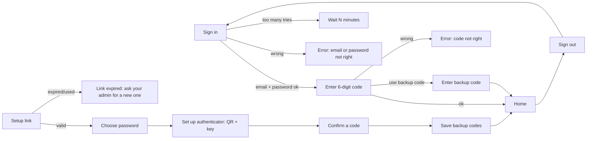

# M1.3 Sign-in with 2FA — UI spec

Date: 2026-11-21 — Design note: `docs/design/m1-3-sign-in.md` — Status: written while PM away; PM reviews on return

## User and task
- User: a family member on a phone or computer (any tech confidence).
- Task: get in safely; first time, set a password and turn on 2FA.
- Success: first-time setup in < 5 minutes without help; daily sign-in in < 30 s; no lockouts that need the admin.

## Flow

## States matrix

| Screen / component | Default | Hover | Focus | Disabled | Loading | Empty | Error | Success | Long content | Offline | Permission denied |
|---|---|---|---|---|---|---|---|---|---|---|---|
| Sign in (email, password, "Sign in") | Two labelled fields, primary button | Button darker | 2 px focus ring on field/button | Button disabled only while submitting | Button shows "Signing in…", fields read-only | Submitting empty: field errors "Enter your email" / "Enter your password" | Banner "Email or password is not right." + focus moves to banner; 429: "Too many tries. Try again in N minutes." | Goes to code screen | Long email wraps in field (scrolls inside input) | Banner "You're offline. Check your connection and try again." | n/a — public screen |
| Code (6-digit, "Verify", "Use a backup code") | One numeric field (`inputmode=numeric`, `autocomplete=one-time-code`), paste allowed | Link underline thicker | Focus ring | Verify disabled while submitting | "Checking…" | "Enter the 6-digit code from your authenticator app" | "That code is not right. Codes change every 30 seconds — try the newest one." After 5: back to sign in with "Please sign in again." | Home | n/a | Offline banner | n/a |
| Backup code | One text field, paste allowed | as above | Focus ring | while submitting | "Checking…" | "Enter one of your backup codes" | "That backup code is not right or was already used." | Home + notice "You have N backup codes left." | n/a | Offline banner | n/a |
| Setup: choose password | Password + confirm, show/hide toggle, rule "At least 12 characters" | — | Focus ring | while submitting | "Saving…" | Field errors | "Passwords don't match" / "Use at least 12 characters" / "This password is too common — choose another" | Next step | Long password fine | Offline banner | Link invalid → "This link has expired or was already used. Ask your admin for a new one." |
| Setup: authenticator | QR code (alt text: "QR code for your authenticator app"), the key as text with "Copy key", code field | — | Focus ring | while submitting | "Checking…" | "Enter the code your app shows" | "That code is not right. Check your phone's time is set automatically." | Next step | Key wraps, monospace | Offline banner | as above |
| Setup: backup codes | 10 codes in a list, "Copy all", "Download as text", checkbox "I've saved these codes", "Continue" | — | Focus ring | Continue disabled until checkbox ticked | — | n/a | n/a | Home | n/a | Copy/download still work | n/a |
| Home shell (header with name, "Sign out", "Sign out of all devices") | "Welcome, <name>" placeholder | — | Focus ring | — | Skeleton for name | n/a | "Something went wrong. Reload the page." | Sign out → sign-in screen with "You're signed out." | Long name truncated with full name in title attribute | Offline banner | Session expired → sign-in screen with "Your session ended. Please sign in again." |

## Breakpoints
- 320 px: single column, full-width fields and buttons, no sideways scrolling; QR code max 240 px wide.
- ≥ 600 px: centred card, max width 420 px.
- ≥ 1024 px: same card, centred vertically.

## Accessibility notes
- Headings and landmarks: one `h1` per screen ("Sign in", "Enter your code", "Set up your account"); `main` landmark; setup steps announce "Step 2 of 4".
- Focus order: top to bottom; on error, focus moves to the error summary, which links to the fields; nothing covers the focused element (no sticky footers).
- Accessible names: every field has a visible `label`; the show/hide toggle has `aria-pressed` and label "Show password".
- Errors: `aria-describedby` from field to its error text; error summary uses `role="alert"`.
- WCAG 3.3.8: paste allowed in every field; `autocomplete` set (`email`, `current-password`, `new-password`, `one-time-code`) so password managers work.
- Targets: ≥ 44×44 px on touch.
- Motion: no animation beyond the focus ring; respects `prefers-reduced-motion`.
- Contrast: ≥ 4.5:1 text, ≥ 3:1 for focus ring and field borders, in light and dark themes.

## Copy
- Sign in: title "Sign in"; labels "Email", "Password"; button "Sign in".
- Code: title "Enter your code"; help "Open your authenticator app and enter the 6-digit code for Family Asset Vault."; button "Verify"; link "Use a backup code".
- Setup: "Set up your account" · "Step 1 of 3: Choose a password" · "Step 2 of 3: Set up your authenticator app" · "Step 3 of 3: Save your backup codes"; backup help "Each code works once. Keep them somewhere safe, like a password manager or printed with your important papers."
- Errors: as in the states matrix — every one says how to recover.
- Sign out: "Sign out", "Sign out of all devices"; confirmation "You're signed out."
- No "Create account" link anywhere.

## Tokens used
Semantic tokens defined once in `apps/web` as CSS variables, light + dark: `color.bg`, `color.surface`, `color.text`, `color.text.muted`, `color.border`, `color.accent`, `color.text.danger`, `color.bg.danger`, `color.focus`, `space.1–6`, `radius.2`, `font.body`, `font.mono`. No hard-coded colours in components.
